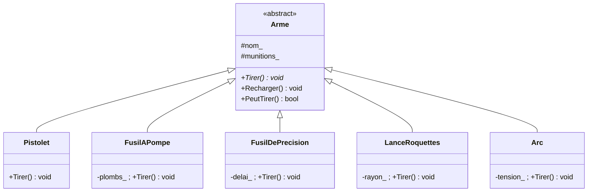

# Formative — OOP — L'armurerie

> Cours associé : [[01 courses/slides/C++/GPR-CF-POO-06 - Héritage et polymorphisme|GPR-CF-POO-06 - Héritage et polymorphisme]]
> Proposée le 12.10.2026, à valider.

## Énoncé

Un stand de tir. Un menu affiche cinq armes, numérotées de **1** à **5**. On tape un
chiffre, l'arme choisie tire, et le stand affiche ce qui s'est passé.

```text
--- STAND DE TIR ---
  1  Pistolet          12 / 12
  2  Fusil a pompe       6 / 6
  3  Fusil de precision  4 / 4
  4  Lance-roquettes     1 / 1
  5  Arc                 1 fleche encochee

  r  recharger    q  quitter
> 2
Fusil a pompe : 8 plombs en cone, 6 degats chacun a bout portant.
```

Les cinq armes ne tirent pas de la même façon :

| Arme | Ce que `tirer()` fait |
|---|---|
| **Pistolet** | un projectile, dégâts fixes, chargeur de 12 |
| **Fusil à pompe** | huit plombs d'un coup, les dégâts chutent avec la distance |
| **Fusil de précision** | un projectile, dégâts élevés, une seconde entre deux tirs |
| **Lance-roquettes** | dégâts de zone autour du point d'impact, une seule roquette |
| **Arc** | les dégâts dépendent du **temps de tension** avant le lâcher |

**La contrainte, qui est tout le sujet** : le menu ne doit contenir **aucun test sur le
type de l'arme**. Pas de `if (type == PISTOLET)`, pas de `switch` sur une énumération
d'armes. Il tient un tableau d'armes, et il appelle.

## La hiérarchie



`Tirer()` est **virtuelle pure** : la base ne sait pas tirer, elle promet seulement que
toute arme sait le faire. Ce qui est commun — le nom, les munitions, le décompte, le
rechargement — reste dans la base, écrit une seule fois.

## Travail demandé

1. **La base.** Écrire `Arme` avec son nom, ses munitions, `Recharger()`, `PeutTirer()`,
   et `Tirer()` en virtuelle pure. Vérifier qu'`Arme arme;` est refusé par le compilateur,
   et recopier le message.
2. **Deux armes.** Dériver `Pistolet` et `FusilAPompe`. Chacune implémente `Tirer()` à sa
   façon, et consomme ses munitions en passant par la base.
3. **Le menu.** Un `std::vector<std::unique_ptr<Arme>>`, et une boucle qui lit un chiffre,
   le transforme en indice, et appelle `Tirer()`. **Aucun test sur le type.**
4. **Les trois autres.** Ajouter `FusilDePrecision`, `LanceRoquettes` et `Arc`. Le menu ne
   doit pas changer d'une ligne.
5. **Le test de l'énoncé.** Ajouter une **sixième** arme de votre invention. Si le menu a
   besoin d'être touché pour autre chose que la ligne qui la crée, la hiérarchie n'est pas
   la bonne.

## Ce qu'on vérifiera

| Je sais… | Vérification |
|---|---|
| écrire une base abstraite | `Arme` ne s'instancie pas, et le compilateur le dit |
| factoriser ce qui est commun | les munitions et le rechargement sont écrits **une fois** |
| laisser l'objet décider | le menu appelle `Tirer()` sans savoir sur quoi |
| fermer ce qui doit l'être | aucun attribut public, `protected` seulement si un enfant s'en sert |
| ne rien casser en ajoutant | la sixième arme n'oblige à toucher ni la base ni le menu |

> [!tip] Le destructeur
> Le tableau tient des `Arme*`. Au moment où il se vide, c'est le destructeur de la **base**
> qui est appelé — et si celui de la base n'est pas `virtual`, celui de l'arme réelle ne
> passe jamais. Ajouter un message dans chaque destructeur et regarder la trace.

## Pistes d'extension

- une arme **composite** : un fusil à double canon qui contient deux armes et les déclenche
  l'une après l'autre. La base ne change pas.
- un **modificateur** appliqué à n'importe quelle arme — silencieux, viseur — qui pose la
  question composition contre héritage, et prépare [[01 courses/slides/Theory/TC-FT-PCL-04 - Composition contre héritage|TC-FT-PCL-04]].
